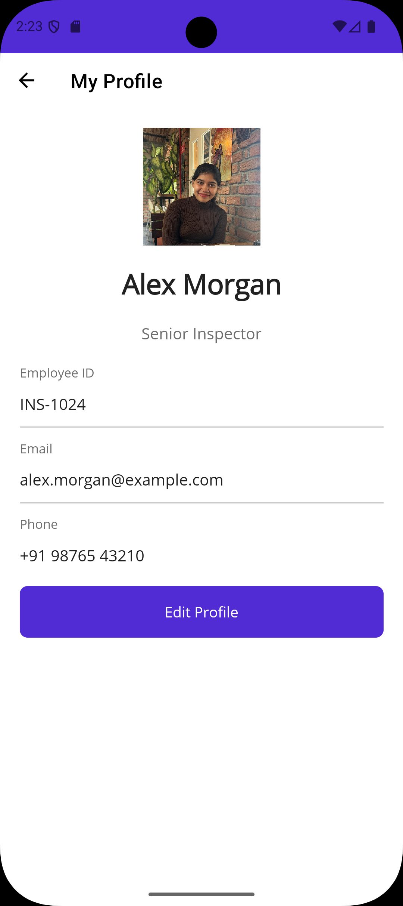
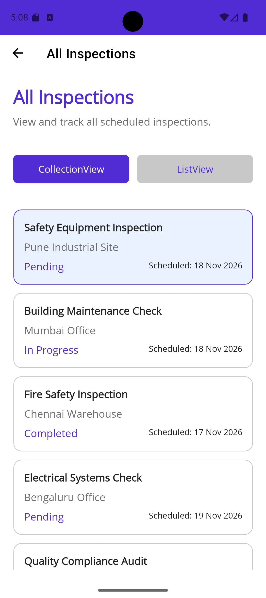
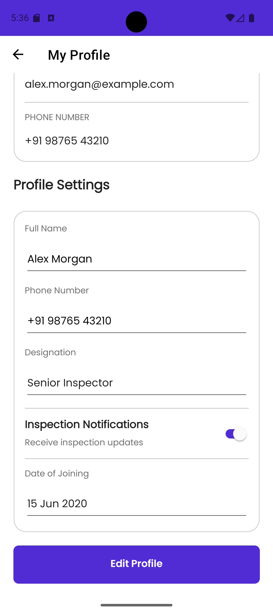

# Assignment 1

## 1. Create a new .NET MAUI application (single project). In the README, explain the project structure in your own words: which files are shared by all platforms, what the Platforms folder contains, and which file starts the app. Run the app on the Android Emulator, and on the iOS Simulator as well where a Mac is available.


## Project Overview

Inspector Management Application is a cross-platform application developed using .NET MAUI. It provides a common codebase for building an application that runs on multiple platforms, including Android, iOS, macOS and Windows.

## Project Structure

The project follows the .NET MAUI single-project structure, where shared code, resources and platform-specific configurations are maintained within one project.

### 1. Shared Files

The following files are shared across supported platforms:

- **App.xaml:** Defines application-level resources, including colors, styles and other shared UI configurations.
- **App.xaml.cs:** Contains the application class and initializes the main application window.
- **AppShell.xaml:** Defines the application's navigation structure using Shell.
- **AppShell.xaml.cs:** Contains the code-behind for the Shell navigation.
- **MauiProgram.cs:** Configures and builds the MAUI application. It is used to register fonts, services, dependencies and other application configurations.
- **InspectorManagementApplication.csproj:** Contains project configuration, target frameworks, dependencies and resource declarations.

### 2. Platforms Folder

The `Platforms` folder contains platform-specific code and configuration required by each operating system.

- **Android:** Contains Android-specific files such as `MainActivity.cs`, `MainApplication.cs` and `AndroidManifest.xml`.
- **iOS:** Contains iOS-specific files such as `AppDelegate.cs` and `Info.plist`.
- **MacCatalyst:** Contains configuration and entry-point files for macOS applications.
- **Windows:** Contains Windows-specific application configuration and entry-point files.

This structure allows the application to reuse shared code while supporting platform-specific functionality when required.

### 3. Resources Folder

The `Resources` folder contains shared assets used throughout the application.

- **AppIcon:** Contains application launcher icons.
- **Fonts:** Contains custom fonts used in the application.
- **Images:** Contains images displayed in the user interface.
- **Raw:** Contains raw assets included with the application.
- **Splash:** Contains splash screen assets displayed while the application starts.
- **Styles:** Contains shared ResourceDictionaries for colors, font sizes, spacing and UI styles.

### 4. Application Startup Flow

The application startup process begins in `MauiProgram.cs`, where the MAUI application is configured and built.

The `App` class in `App.xaml.cs` initializes the application and creates its main window. The window displays the page configured by the application, which in this project is managed through `AppShell`.

The splash screen is displayed during application startup before the main application interface appears.

## Supported Platforms

- Android
- iOS
- MacCatalyst
- Windows


## 2. Log a message in each application lifecycle event of your app (for example Created, Activated, Deactivated, Stopped). Run the app, press the Home button, return to it, and close it. Document in a comment block the order in which the events fired and what you would use each one for in a real app.


``` cs

using System.Diagnostics;

namespace InspectorManagementApplication
{
    public partial class App : Application
    {
        public App()
        {
            InitializeComponent();
        }

        protected override Window CreateWindow(IActivationState? activationState)
        {
            Window window = new Window(new AppShell());

            // Application lifecycle events
            window.Created += (sender, args) =>
                Debug.WriteLine("Lifecycle Event: Created");

            window.Activated += (sender, args) =>
                Debug.WriteLine("Lifecycle Event: Activated");

            window.Deactivated += (sender, args) =>
                Debug.WriteLine("Lifecycle Event: Deactivated");

            window.Stopped += (sender, args) =>
                Debug.WriteLine("Lifecycle Event: Stopped");

            window.Resumed += (sender, args) =>
                Debug.WriteLine("Lifecycle Event: Resumed");

            window.Destroying += (sender, args) =>
                Debug.WriteLine("Lifecycle Event: Destroying");

            return window;
        }
    }
}
```


APPLICATION LIFECYCLE OBSERVATIONS

Tested on: Android Emulator

1. Created:
   Raised when the application window is created.
   Real-world use: Initialize application resources.

2. Activated:
   Raised when the application window becomes active.
   Real-world use: Refresh data and enable user interaction.

3. Deactivated:
   Raised when the application loses focus.
   Real-world use: Pause animations and ongoing UI activities.

4. Stopped:
   Raised when the application window is no longer visible.
   Real-world use: Stop unnecessary background operations
   and release resources.

5. Resumed:
   Raised when the application resumes after being stopped.
   Real-world use: Refresh visible content and resume activities.

6. Destroying:
   Raised when the native window is being destroyed.
   Real-world use: Clean up event subscriptions and resources.

Observed event sequence:
[Write the actual sequence obtained during testing.]

Note: Lifecycle event order and termination behavior
can vary depending on the platform and operating system.


## 3. Create InspectorProfilePage in XAML showing a photo (Image), name, employee ID, role, email and phone, and an Edit button. No wireframe is given, so you design the layout using VerticalStackLayout and HorizontalStackLayout.




## 4. Make sure no content is hidden behind the notch, status bar or home indicator. Document what you did to handle the safe area and why it was needed.

### Safe Area Handling

**Implementation:**
- Set `SafeAreaEdges="All"` on the root `ContentPage` of the application pages.
- This allows .NET MAUI to automatically apply the required insets.

**Why was it needed?**

Modern Android devices have system UI elements such as the status bar, navigation bar, gesture area and display cutouts. Without safe-area handling, application content may overlap these areas and become difficult to see or interact with.

**Result:**

The application content stays within the visible screen area, avoiding overlap with system UI elements and the keyboard.

## 5. Create DashboardPage using a Grid: four summary cards (Total, Pending, In Progress, Completed) with hardcoded counts for now, and a 'Today's inspections' area. Show priority tags (High, Medium, Low) in a FlexLayout so that they wrap onto the next line when there is no room. In a comment, explain where you used Auto, * (star) and absolute sizes in your row and column definitions and why.


### Grid Sizing Explanation

The Dashboard uses `Auto`, `*` (star), and absolute sizing in its Grid row and column definitions.

- **Auto sizing:** Used in `RowDefinitions="Auto,*,1"` for the dashboard header. The header takes only the height required by its content, avoiding unnecessary empty space.

- **Star (*) sizing:** Used in `RowDefinitions="Auto,*,1"` for the ScrollView. It occupies the remaining available screen height. Also used in `ColumnDefinitions="*,*"` to divide the summary cards into two equal-width columns.

- **Absolute sizing:** Used in the third row of `RowDefinitions="Auto,*,1"` to reserve a fixed 1-unit height for the bottom divider. This keeps the divider's size consistent.

- **Auto column sizing:** Used in `ColumnDefinitions="*,Auto"` for inspection cards. The inspection title takes the available width, while the priority badge takes only the space it needs.

These sizing options make the dashboard responsive and help its content adjust to different screen sizes.

## 6. Test the layout in portrait and landscape and on a small and a large emulator. Nothing may be clipped or overlapping. Save before and after screenshots in a /docs folder and note what you had to change.

### Testing Devices

The dashboard was tested on two Android emulator profiles:

- **Small Device:** Pixel 4a
- **Large Device:** Pixel 9

Both devices were tested in portrait and landscape orientations.

### Test Results

| Device | Orientation | Result |
|---|---|---|
| Pixel 4a | Portrait | Passed |
| Pixel 4a | Landscape | Passed |
| Pixel 9 | Portrait | Passed |
| Pixel 9 | Landscape | Passed |

### Observations

- Dashboard content remains readable across different screen sizes.
- Summary cards maintain a two-column layout.
- Inspection details are displayed correctly.
- The `ScrollView` allows users to scroll vertically when content exceeds the available screen height.
- No horizontal clipping or major layout issues were observed.
- The layout works in both portrait and landscape orientations.

### Conclusion

Responsive testing was completed successfully on small and large Android emulator profiles.


## 7. Create InspectionListPage using a CollectionView with at least 10 hardcoded inspections (title, site, status, scheduled date) and an ItemTemplate. Highlight the selected item. Then build the same list once using a ListView and write a short comparison: which one would you choose for a list of 1,000 items, and why?




### Implementation

Created two inspection list pages using the same `Inspection` model and 10 hardcoded inspection records.

**1. CollectionView**
- Displays inspections using an `ItemTemplate`.
- Supports single-item selection.
- Highlights the selected item using Visual States.
- Provides better performance for larger data collections.

**2. ListView**
- Displays the same 10 inspection records.
- Uses `ViewCell` and an `ItemTemplate`.
- Included for comparison with CollectionView.

### CollectionView vs ListView

| Feature | CollectionView | ListView |
|---|---|---|
| Performance | Better for large lists | Less efficient for large lists |
| Layout | Supports flexible layouts | Primarily list-based |
| Selection | Supports item selection | Supports item selection |
| Status | Recommended for modern MAUI apps | Deprecated |

### Which would I choose for 1,000 items?

I would choose **CollectionView** because it provides better performance, supports flexible layouts, and is the recommended control for displaying collections in modern .NET MAUI applications.

ListView is deprecated, so CollectionView is the better choice for new applications.


## 8. Use at least five different common controls across your pages (for example Label, Button, Entry, Image, Picker, Switch, DatePicker). Include an image and a custom font added through the project's Resources.



## 9. Move every colour, font size and spacing value into a ResourceDictionary. No page may contain a hardcoded colour. Use StaticResource and define at least one implicit style and two explicit styles.


Centralized colours, font sizes, and spacing values using shared ResourceDictionaries.

### Implementation

- Used `Colors.xaml` for colour definitions.
- Used `FontSizes.xaml` for font sizes and Poppins font families.
- Used `Spacing.xaml` for padding and spacing values.
- Applied resources throughout the pages using `StaticResource`.
- Removed hardcoded colour, font-size, and spacing values from page XAML.
- Created implicit styles for controls such as Label, Button, Entry, and Picker.
- Created explicit styles including `PageTitleStyle` and `PrimaryButtonStyle`.

### Result

Achieved consistent styling and typography across the Dashboard, Profile, and Inspection List pages. Changes to shared resources can now be applied throughout the application.


## 10. Create a reusable custom control StatusBadge (a ContentView with a bindable Status property) that shows Pending, In Progress or Completed in a different colour. Use it on the list and on the dashboard. Create a ControlTemplate for a card and use it on both the dashboard and the profile page.


## 11. Write REFACTOR.md: list at least 3 places where you removed duplicated XAML or simplified a layout, with a short before and after for each.

``` REFRACTOR.md ```


# Assignment 2

## 1. Create Models, ViewModels and Views folders and an Inspection model (Id, Title, SiteName, Status, Priority, ScheduledOn, InspectorName, Notes). Write a BaseViewModel that implements INotifyPropertyChanged yourself. Do not use a toolkit or source generator in this assignment.

### Project Structure
Created separate folders to organize the application:
- **Models:** Contains the Inspection model.
- **Views:** Contains the UI pages.
- **ViewModels:** Contains presentation logic and data-binding properties.

### Inspection Model
Created an `Inspection` model with the following properties:
- Id
- Title
- SiteName
- Status
- Priority
- ScheduledOn
- InspectorName
- Notes

### BaseViewModel
Implemented a custom `BaseViewModel` class that implements `INotifyPropertyChanged` without using MVVM Toolkit or source generators.

It includes:
- `PropertyChanged` event to notify the UI about property changes.
- `OnPropertyChanged()` method to raise notifications.
- `SetProperty()` helper method to update backing fields and notify the UI only when values change.

This provides a reusable foundation for the application's ViewModels.


## 2. Create InspectionListViewModel with an ObservableCollection of inspections and bind InspectionListPage to it. The code-behind may contain only InitializeComponent and the BindingContext assignment. Experiment: replace the ObservableCollection with a plain List and add an item at runtime. Document what happens and why.

### ViewModel Implementation
Created `InspectionListViewModel`, inheriting from `BaseViewModel`.

- Used `ObservableCollection<Inspection>` to store inspection records.
- Moved all 10 sample inspection records from `InspectionListPage` into the ViewModel.
- Added inspection properties such as `Id`, `Title`, `SiteName`, `Status`, `Priority`, and `ScheduledOn`.

### Binding InspectionListPage
- Set the page's `BindingContext` to an instance of `InspectionListViewModel`.
- Bound both `CollectionView` and `ListView` to the `Inspections` collection using `ItemsSource="{Binding Inspections}"`.
- Updated XAML bindings to match the renamed model properties `SiteName` and `ScheduledOn`.
- Removed hardcoded inspection data and `ItemsSource` assignments from the page constructor.

### ObservableCollection vs List Experiment

| ObservableCollection | List |
|---|---|
| Notifies the UI when items are added or removed. | Does not notify the UI when items are added or removed. |
| Automatically updates a bound collection control when the collection changes. | The UI does not automatically reflect collection changes. |

**Observation:** Both collections display the initial inspection records correctly because the data is available when the page is bound.

However, when a new inspection is added at runtime, `ObservableCollection` automatically notifies the UI and displays the new item. A plain `List` does not provide collection-change notifications, so the UI does not automatically update.

**Conclusion:** `ObservableCollection` is preferred for data-bound collections when items may be added or removed dynamically.

## 3. Add an IsBusy property. Load the list with a simulated 2-second delay and show an ActivityIndicator while loading. In the README, describe which responsibilities sit in the Model, the View and the ViewModel in your app.

### IsBusy and Asynchronous Loading
- Added an `IsBusy` property to `InspectionListViewModel` to track the loading state.
- Implemented `LoadInspectionsAsync()` to simulate data loading using `Task.Delay(2000)`.
- Set `IsBusy` to `true` before loading and reset it to `false` in a `finally` block.
- Populated the `ObservableCollection<Inspection>` after the simulated delay.
- Added an `ActivityIndicator` to `InspectionListPage.xaml`.
- Bound the indicator's `IsRunning` and `IsVisible` properties to `IsBusy`, so it appears while loading and disappears afterward.

### MVVM Responsibilities

| Component | Responsibility in the application |
|---|---|
| **Model** | The `Inspection` class represents inspection data, including Id, Title, SiteName, Status, Priority, ScheduledOn, InspectorName and Notes. |
| **View** | `InspectionListPage.xaml` defines the user interface, including the inspection list, view switcher, labels, buttons and ActivityIndicator. |
| **ViewModel** | `InspectionListViewModel` manages the inspection collection, loading logic and `IsBusy` state. It exposes properties that the View accesses through data binding. |

### Conclusion
MVVM separates the application into three responsibilities:
- **Model:** Represents the data.
- **View:** Displays the user interface.
- **ViewModel:** Handles presentation logic and connects the Model with the View through data binding.

This separation makes the application easier to maintain, test and extend.


## 4. Add a search Entry bound TwoWay to a SearchText property. The list must filter as the user types, with no search button. In the README, list at least six bindings in your app in a table (control, property, mode, direction) and explain why you chose OneWay or TwoWay for each.

### Search Implementation
- Added a Search Entry to `InspectionListPage.xaml`.
- Bound its `Text` property to the ViewModel's `SearchText` property using `Mode=TwoWay`.
- Implemented filtering inside `InspectionListViewModel`.
- Used a separate `_allInspections` list to preserve the complete dataset.
- Used `ObservableCollection<Inspection>` for displaying filtered results.
- Filtering happens automatically whenever the user types, without requiring a search button.
- Search is case-insensitive and checks Title, SiteName, Status, Priority and InspectorName.

### Data Binding Table

| Control | Property | Mode | Direction |
|---|---|---|---|
| Search Entry | Text | TwoWay | View ↔ ViewModel |
| CollectionView | ItemsSource | OneWay | ViewModel → View |
| CollectionView | SelectedItem | TwoWay | View ↔ ViewModel |
| CollectionView | IsVisible | OneWay | ViewModel → View |
| ListView | ItemsSource | OneWay | ViewModel → View |
| ListView | IsVisible | OneWay | ViewModel → View |
| ActivityIndicator | IsRunning | OneWay | ViewModel → View |
| ActivityIndicator | IsVisible | OneWay | ViewModel → View |
| Collection View Button | Command | OneWay | ViewModel → View |
| List View Button | Command | OneWay | ViewModel → View |

### OneWay vs TwoWay Binding

**OneWay:** Data flows from the ViewModel to the View. It is suitable for displaying information or state that the user does not directly edit.

Examples: `ItemsSource`, `IsVisible`, and `IsRunning`.

**TwoWay:** Data flows in both directions. When the user changes a control, the ViewModel property updates, and changes to the ViewModel can also update the control.

Examples: Search Entry `Text` and CollectionView `SelectedItem`.

### Conclusion
Two-way binding allows the search input to update `SearchText` immediately. The ViewModel filters the inspection collection whenever the text changes, providing live search without a separate search button.


## 5. Write three value converters: StatusToColorConverter, a date-to-relative-text converter (such as '3 days ago', no libraries), and an inverse-boolean converter used to show an empty-state message when the search finds nothing.

Implemented three custom value converters in the `Converters` folder and registered them in `App.xaml` as application-level resources.

1. **StatusToColorConverter:** Converts inspection status into a corresponding color: Pending (Orange), In Progress (Blue), and Completed (Green).
2. **DateToRelativeTextConverter:** Converts `DateTime` values into relative text such as Today, Tomorrow, Yesterday, and 3 days ago using built-in .NET functionality.
3. **InverseBooleanConverter:** Reverses boolean values. Used with `HasInspections` to display the empty-state message when the filtered collection has no records.

Converters separate presentation logic from the ViewModel and allow reusable value transformations in XAML.


## 6. Create LoginPage with Email and Password entries. Validate the email format and a password of at least 8 characters. Show the error message under each field, and keep the Login button disabled until both are valid. Check the credentials against a hardcoded user for now.


Created a `LoginPage` using MVVM with email and password validation.

### Features
- Email validation using Regex to check the email format.
- Password validation requiring at least 8 characters.
- Error messages displayed below their respective fields.
- Login button remains disabled until both fields are valid.
- Hardcoded credential verification for testing.

### Test Credentials
- **Email:** admin@example.com
- **Password:** Admin@123

### Login Results
- Successful login displays a green success message.
- Incorrect credentials display a red error message.
- Editing either field clears the previous login result.

### MVVM Implementation
- `LoginViewModel` handles validation and credential checking.
- `LoginPage.xaml` contains the UI and data bindings.
- `LoginPage.xaml.cs` initializes the ViewModel and handles the Login button click.
- `App.xaml.cs` opens LoginPage as the temporary startup page.


## 7. Write your own RelayCommand with CanExecute and an AsyncRelayCommand. Use them for Login and for loading the list, so that a second tap while one is running does nothing. Document what happens if the user taps Login twice very quickly, with and without your protection.

- Created a custom `RelayCommand` supporting `CanExecute` for synchronous actions.
- Created an `AsyncRelayCommand` to execute asynchronous operations.
- Used `RelayCommand` for Login and `AsyncRelayCommand` for loading inspections.
- `AsyncRelayCommand` prevents multiple executions while an operation is running by disabling the button until it completes.

**Experiment – Rapid repeated taps:**
- Without execution protection, repeated taps can trigger the same operation multiple times.
- With `AsyncRelayCommand`, the first tap starts loading and disables the button. Further taps are ignored until loading finishes.
- The button becomes enabled again after the operation completes.


## 8. Add pull-to-refresh to the list using a RefreshView bound to a command. Add one event-based handler (for example SelectionChanged) and note in a comment why that case needed an event instead of a command.

- Added `RefreshView` to both CollectionView and ListView.
- Bound `Command` to `LoadInspectionsCommand` and `IsRefreshing` to `IsBusy`.
- Added a `SelectionChanged` event handler to CollectionView.
- Used an event because `SelectionChangedEventArgs` provides the newly selected item through `CurrentSelection`.

**Result:** Pulling down refreshes the inspection list, and selecting an item triggers the event handler.

## 9. Set up AppShell with a TabBar (Dashboard, Inspections, Profile) and keep the login flow outside the tabs. Register a route for InspectionDetailPage and pass the inspection Id as a parameter. The detail page loads and shows the full inspection.


- Created a Shell `TabBar` with Dashboard, Inspections, and Profile tabs.
- Kept LoginPage outside the Shell tabs.
- Registered `InspectionDetailPage` as a Shell route.
- Created a shared `InspectionService` to retrieve inspections.
- Passed the selected inspection's Id through Shell navigation.
- Created `InspectionDetailViewModel` to retrieve the full inspection using that Id.

**Result:** Selecting an inspection from either view opens its detail page.


## 10. Open a 'New Inspection' page as a modal with Save and Cancel. If the user has typed something and presses Cancel, ask for confirmation before discarding the changes.


- Created `NewInspectionPage` to add a new inspection.
- Opened the page as a modal using `Navigation.PushModalAsync()`.
- Added fields for title, site, status, priority, scheduled date, inspector name, and notes.
- Used `NewInspectionViewModel` to handle form data and Save/Cancel commands.
- On Save, created an `Inspection` object and added it to `InspectionService`.
- On Cancel, checked whether any fields had been entered. If changes existed, displayed a confirmation alert before discarding them.
- Closed the modal using `Navigation.PopModalAsync()`.

**Result:** Users can add a new inspection through a modal form or cancel it with a confirmation prompt if they have entered data.


## 11. In the README, add a table of routes (route, page, parameters). Explain why you used Shell routes instead of calling PushAsync directly, and when direct navigation would have been the better choice.

### Route Table

| Route | Page | Parameters |
|---|---|---|
| `DashboardPage` | DashboardPage | None |
| `InspectionListPage` | InspectionListPage | None |
| `ProfilePage` | ProfilePage | None |
| `InspectorProfilePage` | InspectorProfilePage | None |
| `InspectionDetailPage` | InspectionDetailPage | `inspectionId` – ID of the selected inspection |

### Why Shell Routes?

I used Shell navigation with `Routing.RegisterRoute()` and `Shell.Current.GoToAsync()` for navigating between pages.

- Shell provides a centralized way to manage application navigation.
- It supports URI-based navigation and passing parameters between pages.
- It integrates with the TabBar, making navigation between Dashboard, Inspections, and Profile straightforward.
- It keeps navigation logic separate from page creation.

For example, when a user selects an inspection, the app navigates to its details page using:

```csharp
await Shell.Current.GoToAsync(
    $"{nameof(InspectionDetailPage)}?inspectionId={inspection.Id}");
```

The `InspectionId` property receives the parameter through `QueryProperty`.

### When Would Direct Navigation Be Better?

Direct navigation using `Navigation.PushAsync()` would be a better choice for simple, local navigation flows that do not need Shell route management, such as opening a temporary page in a `NavigationPage` stack.

For example, I used `Navigation.PushModalAsync()` for `NewInspectionPage` because it is a temporary form that should appear modally and close independently using `Navigation.PopModalAsync()`.

**Conclusion:** Shell routes are suitable for the app's main navigation and detail pages, while direct navigation is useful for simple page stacks and modal workflows.