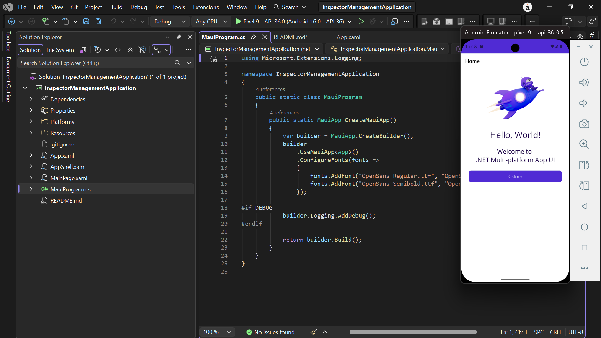
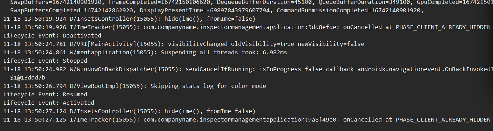
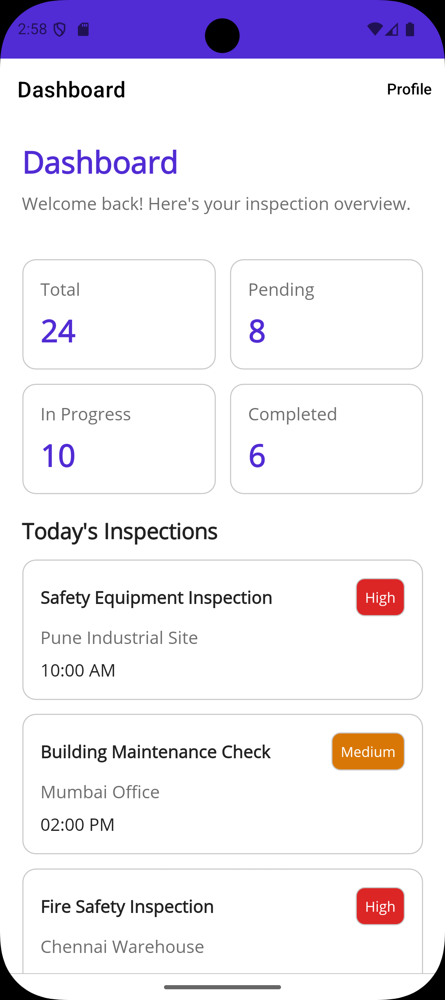
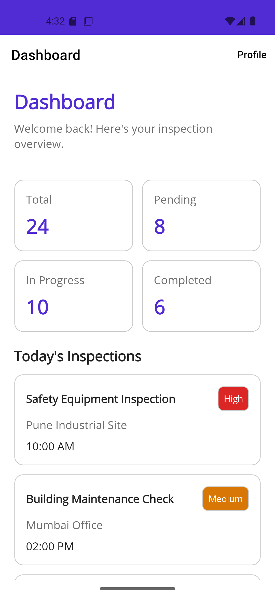
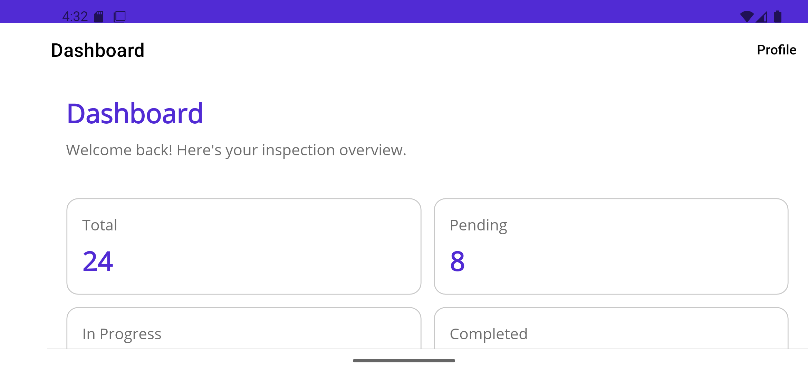
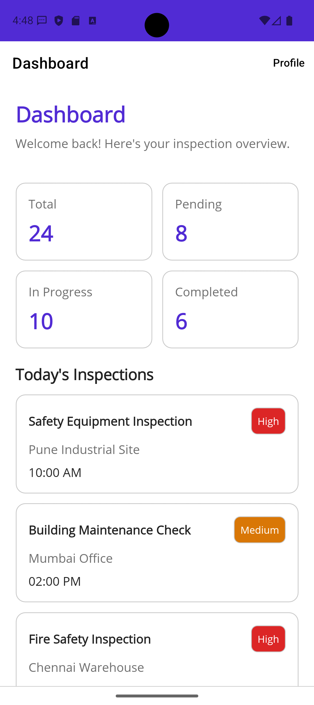
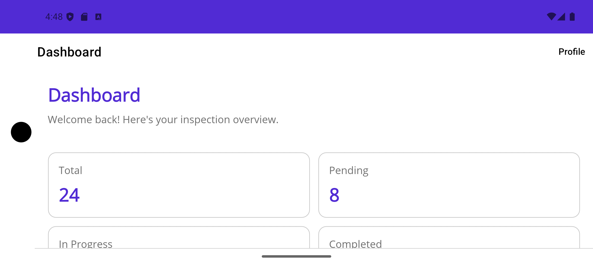
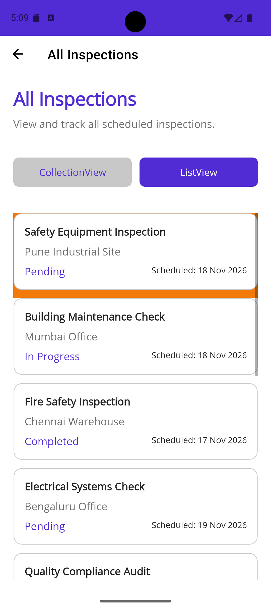
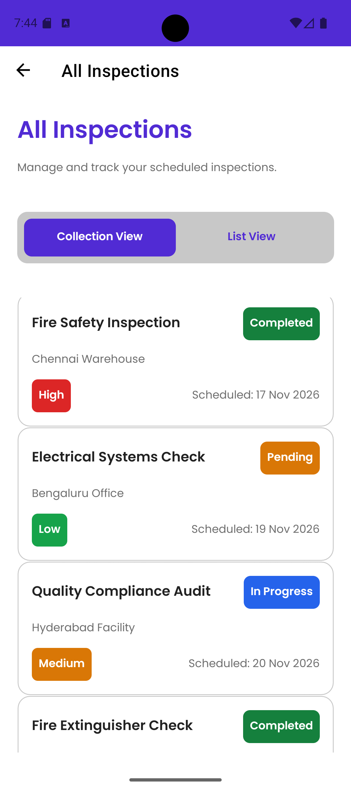

# Assignment 1

## 1. Create a new .NET MAUI application (single project). In the README, explain the project structure in your own words: which files are shared by all platforms, what the Platforms folder contains, and which file starts the app. Run the app on the Android Emulator, and on the iOS Simulator as well where a Mac is available.


## Project Overview

Inspector Management Application is a cross-platform application developed using .NET MAUI. It provides a common codebase for building an application that runs on multiple platforms, including Android, iOS, macOS and Windows.

## Project Structure

The project follows the .NET MAUI single-project structure, where shared code, resources and platform-specific configurations are maintained within one project.

### 1. Shared Files

The following files are shared across supported platforms:

- **App.xaml:** Defines application-level resources, including colors, styles and other shared UI configurations.
- **App.xaml.cs:** Contains the application class and initializes the main application window.
- **AppShell.xaml:** Defines the application's navigation structure using Shell.
- **AppShell.xaml.cs:** Contains the code-behind for the Shell navigation.
- **MauiProgram.cs:** Configures and builds the MAUI application. It is used to register fonts, services, dependencies and other application configurations.
- **InspectorManagementApplication.csproj:** Contains project configuration, target frameworks, dependencies and resource declarations.

### 2. Platforms Folder

The `Platforms` folder contains platform-specific code and configuration required by each operating system.

- **Android:** Contains Android-specific files such as `MainActivity.cs`, `MainApplication.cs` and `AndroidManifest.xml`.
- **iOS:** Contains iOS-specific files such as `AppDelegate.cs` and `Info.plist`.
- **MacCatalyst:** Contains configuration and entry-point files for macOS applications.
- **Windows:** Contains Windows-specific application configuration and entry-point files.

This structure allows the application to reuse shared code while supporting platform-specific functionality when required.

### 3. Resources Folder

The `Resources` folder contains shared assets used throughout the application.

- **AppIcon:** Contains application launcher icons.
- **Fonts:** Contains custom fonts used in the application.
- **Images:** Contains images displayed in the user interface.
- **Raw:** Contains raw assets included with the application.
- **Splash:** Contains splash screen assets displayed while the application starts.
- **Styles:** Contains shared ResourceDictionaries for colors, font sizes, spacing and UI styles.

### 4. Application Startup Flow

The application startup process begins in `MauiProgram.cs`, where the MAUI application is configured and built.

The `App` class in `App.xaml.cs` initializes the application and creates its main window. The window displays the page configured by the application, which in this project is managed through `AppShell`.

The splash screen is displayed during application startup before the main application interface appears.

## Supported Platforms

- Android
- iOS
- MacCatalyst
- Windows





## 2. Log a message in each application lifecycle event of your app (for example Created, Activated, Deactivated, Stopped). Run the app, press the Home button, return to it, and close it. Document in a comment block the order in which the events fired and what you would use each one for in a real app.


``` cs

using System.Diagnostics;

namespace InspectorManagementApplication
{
    public partial class App : Application
    {
        public App()
        {
            InitializeComponent();
        }

        protected override Window CreateWindow(IActivationState? activationState)
        {
            Window window = new Window(new AppShell());

            // Application lifecycle events
            window.Created += (sender, args) =>
                Debug.WriteLine("Lifecycle Event: Created");

            window.Activated += (sender, args) =>
                Debug.WriteLine("Lifecycle Event: Activated");

            window.Deactivated += (sender, args) =>
                Debug.WriteLine("Lifecycle Event: Deactivated");

            window.Stopped += (sender, args) =>
                Debug.WriteLine("Lifecycle Event: Stopped");

            window.Resumed += (sender, args) =>
                Debug.WriteLine("Lifecycle Event: Resumed");

            window.Destroying += (sender, args) =>
                Debug.WriteLine("Lifecycle Event: Destroying");

            return window;
        }
    }
}
```



APPLICATION LIFECYCLE OBSERVATIONS

Tested on: Android Emulator

1. Created:
   Raised when the application window is created.
   Real-world use: Initialize application resources.

2. Activated:
   Raised when the application window becomes active.
   Real-world use: Refresh data and enable user interaction.

3. Deactivated:
   Raised when the application loses focus.
   Real-world use: Pause animations and ongoing UI activities.

4. Stopped:
   Raised when the application window is no longer visible.
   Real-world use: Stop unnecessary background operations
   and release resources.

5. Resumed:
   Raised when the application resumes after being stopped.
   Real-world use: Refresh visible content and resume activities.

6. Destroying:
   Raised when the native window is being destroyed.
   Real-world use: Clean up event subscriptions and resources.

Observed event sequence:
[Write the actual sequence obtained during testing.]

Note: Lifecycle event order and termination behavior
can vary depending on the platform and operating system.


## 3. Create InspectorProfilePage in XAML showing a photo (Image), name, employee ID, role, email and phone, and an Edit button. No wireframe is given, so you design the layout using VerticalStackLayout and HorizontalStackLayout.


## 4. Make sure no content is hidden behind the notch, status bar or home indicator. Document what you did to handle the safe area and why it was needed.

### Safe Area Handling

**Implementation:**
- Set `SafeAreaEdges="All"` on the root `ContentPage` of the application pages.
- This allows .NET MAUI to automatically apply the required insets.

**Why was it needed?**

Modern Android devices have system UI elements such as the status bar, navigation bar, gesture area and display cutouts. Without safe-area handling, application content may overlap these areas and become difficult to see or interact with.

**Result:**

The application content stays within the visible screen area, avoiding overlap with system UI elements and the keyboard.

## 5. Create DashboardPage using a Grid: four summary cards (Total, Pending, In Progress, Completed) with hardcoded counts for now, and a 'Today's inspections' area. Show priority tags (High, Medium, Low) in a FlexLayout so that they wrap onto the next line when there is no room. In a comment, explain where you used Auto, * (star) and absolute sizes in your row and column definitions and why.



### Grid Sizing Explanation

The Dashboard uses `Auto`, `*` (star), and absolute sizing in its Grid row and column definitions.

- **Auto sizing:** Used in `RowDefinitions="Auto,*,1"` for the dashboard header. The header takes only the height required by its content, avoiding unnecessary empty space.

- **Star (*) sizing:** Used in `RowDefinitions="Auto,*,1"` for the ScrollView. It occupies the remaining available screen height. Also used in `ColumnDefinitions="*,*"` to divide the summary cards into two equal-width columns.

- **Absolute sizing:** Used in the third row of `RowDefinitions="Auto,*,1"` to reserve a fixed 1-unit height for the bottom divider. This keeps the divider's size consistent.

- **Auto column sizing:** Used in `ColumnDefinitions="*,Auto"` for inspection cards. The inspection title takes the available width, while the priority badge takes only the space it needs.

These sizing options make the dashboard responsive and help its content adjust to different screen sizes.

## 6. Test the layout in portrait and landscape and on a small and a large emulator. Nothing may be clipped or overlapping. Save before and after screenshots in a /docs folder and note what you had to change.

### Testing Devices

The dashboard was tested on two Android emulator profiles:

- **Small Device:** Pixel 4a
- **Large Device:** Pixel 9

Both devices were tested in portrait and landscape orientations.

### Test Results

| Device | Orientation | Result |
|---|---|---|
| Pixel 4a | Portrait | Passed |
| Pixel 4a | Landscape | Passed |
| Pixel 9 | Portrait | Passed |
| Pixel 9 | Landscape | Passed |

### Observations

- Dashboard content remains readable across different screen sizes.
- Summary cards maintain a two-column layout.
- Inspection details are displayed correctly.
- The `ScrollView` allows users to scroll vertically when content exceeds the available screen height.
- No horizontal clipping or major layout issues were observed.
- The layout works in both portrait and landscape orientations.

### Conclusion

Responsive testing was completed successfully on small and large Android emulator profiles.









## 7. Create InspectionListPage using a CollectionView with at least 10 hardcoded inspections (title, site, status, scheduled date) and an ItemTemplate. Highlight the selected item. Then build the same list once using a ListView and write a short comparison: which one would you choose for a list of 1,000 items, and why?




### Implementation

Created two inspection list pages using the same `Inspection` model and 10 hardcoded inspection records.

**1. CollectionView**
- Displays inspections using an `ItemTemplate`.
- Supports single-item selection.
- Highlights the selected item using Visual States.
- Provides better performance for larger data collections.

**2. ListView**
- Displays the same 10 inspection records.
- Uses `ViewCell` and an `ItemTemplate`.
- Included for comparison with CollectionView.

### CollectionView vs ListView

| Feature | CollectionView | ListView |
|---|---|---|
| Performance | Better for large lists | Less efficient for large lists |
| Layout | Supports flexible layouts | Primarily list-based |
| Selection | Supports item selection | Supports item selection |
| Status | Recommended for modern MAUI apps | Deprecated |

### Which would I choose for 1,000 items?

I would choose **CollectionView** because it provides better performance, supports flexible layouts, and is the recommended control for displaying collections in modern .NET MAUI applications.

ListView is deprecated, so CollectionView is the better choice for new applications.


## 8. Use at least five different common controls across your pages (for example Label, Button, Entry, Image, Picker, Switch, DatePicker). Include an image and a custom font added through the project's Resources.


## 9. Move every colour, font size and spacing value into a ResourceDictionary. No page may contain a hardcoded colour. Use StaticResource and define at least one implicit style and two explicit styles.


Centralized colours, font sizes, and spacing values using shared ResourceDictionaries.

### Implementation

- Used `Colors.xaml` for colour definitions.
- Used `FontSizes.xaml` for font sizes and Poppins font families.
- Used `Spacing.xaml` for padding and spacing values.
- Applied resources throughout the pages using `StaticResource`.
- Removed hardcoded colour, font-size, and spacing values from page XAML.
- Created implicit styles for controls such as Label, Button, Entry, and Picker.
- Created explicit styles including `PageTitleStyle` and `PrimaryButtonStyle`.

### Result

Achieved consistent styling and typography across the Dashboard, Profile, and Inspection List pages. Changes to shared resources can now be applied throughout the application.


## 10. Create a reusable custom control StatusBadge (a ContentView with a bindable Status property) that shows Pending, In Progress or Completed in a different colour. Use it on the list and on the dashboard. Create a ControlTemplate for a card and use it on both the dashboard and the profile page.



## 11. Write REFACTOR.md: list at least 3 places where you removed duplicated XAML or simplified a layout, with a short before and after for each.

``` REFRACTOR.md ```